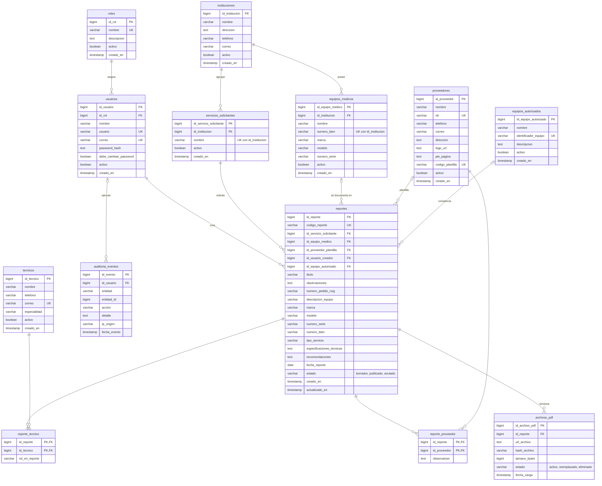

# Modelo relacional final - Entrega 4

Diagrama editable del esquema implementado en `sql/ddl/001_schema.sql`. La
imagen exportada está en `docs/diagramas/ENTREGA4_MODELO_RELACIONAL.png`.
Para regenerarla, pegue el bloque Mermaid en https://mermaid.live y exporte PNG.

- Entidades principales: roles, usuarios, equipos_autorizados, instituciones,
  servicios_solicitantes, equipos_medicos, tecnicos, proveedores, reportes,
  archivos_pdf y auditoria_eventos.
- Relaciones N:M resueltas: `reporte_tecnico` (reportes ↔ técnicos) y
  `reporte_proveedor` (reportes ↔ proveedores).
- Las FK usan `ON UPDATE CASCADE`; `ON DELETE RESTRICT` salvo las asociativas y
  `archivos_pdf` (`CASCADE`), y `equipos_autorizados` y `auditoria_eventos`
  (`SET NULL`).

Los datos del equipo copiados en `reportes` (descripción, marca, modelo, serie y
bien) son una instantánea histórica intencional: conservan lo que se documentó
aunque el inventario cambie después, por lo que no violan la 3FN.
